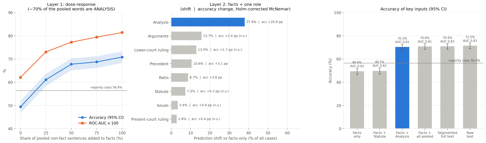
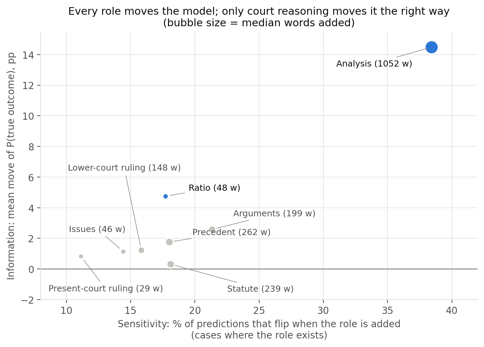
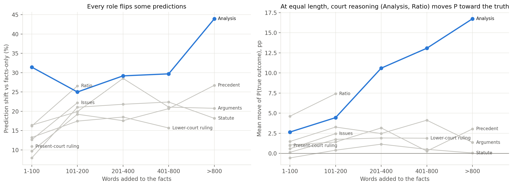
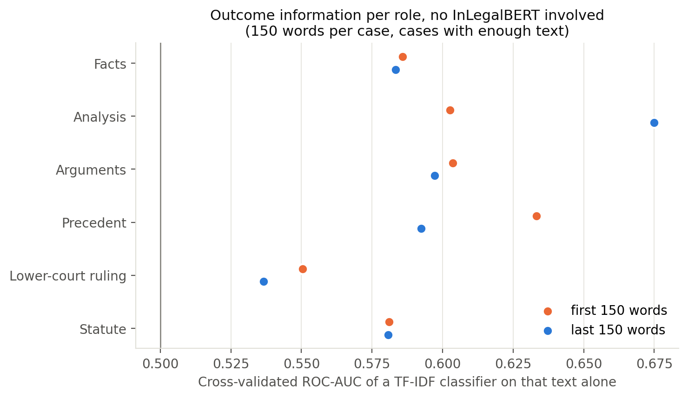

# Stage 2 — Behavioural ablation: results

**Status (12 Oct 2026):** the v2 run and the control experiments are both run and analysed. All six
controls support the leakage claim (Section 7.1). Every number here comes from `stage2_outputs/` and is
regenerated by `python stage2_analysis.py --controls predex_stage2_controls.jsonl`.

## 1. The result in one paragraph

The model's accuracy comes from the **court's own Analysis section** (the deciding judge's discussion of the
evidence and the law), not from the facts and not from statutes. Facts alone give ROC-AUC 0.62. Adding the
Analysis section raises it to 0.81, close to the full judgment's 0.83, and accuracy rises from 49.4% to 70.3%.
Adding statute sentences changes nothing (+0.3 pp, CI −1.2 to +1.8). Swapping or masking section numbers
barely moves predictions. Every role flips some predictions when it is added, and longer additions flip
more. But at the same added length, only court reasoning (Analysis, and the short Ratio) moves predictions
toward the correct outcome. A bag-of-words classifier with no InLegalBERT finds the same signal, and it is
concentrated in the **last** words of the Analysis section, the text just before the decision that the
dataset removed.

This is outcome leakage from post-decisional text: the model learned to read the outcome from the judge's
reasoning, not to predict it from the facts. That text does not exist when a pending case is predicted, and
accuracy alone cannot reveal the problem.

## 2. What changed since the Phase-3 Review-1 deck

The Review-1 numbers came from the v1 script, where `STA` and `ISSUE` sentences were silently relabelled
`NONE` and the variant named `v_sta_only` was actually built from `ANALYSIS`. The fixed script and its
changelog are in `opennyai_ablation_fixed.py`.

| Claim in the Review-1 deck | v2 result |
|---|---|
| "Statute-analysis content is the dominant shortcut: 37.8% shift, 70.4% accuracy" | That variant was facts + **Analysis**. The real statute variant: 7.3% shift, 49.7% accuracy, no different from facts only (Holm-corrected McNemar p = 1.0) |
| "Facts-only sits at chance (50.1%)" | 49.4% accuracy, but AUC 0.62. On facts-only input the model predicts "accepted" for only 13% of cases against a 56% base rate. With the threshold moved to the base rate, accuracy is 60.1%. Facts carry a weak signal; the 0.5 threshold is wrong for short inputs |
| "Arguments + Ratio control: 19.9% shift" | Split into two variants. Arguments 15.7%, Ratio 8.7%. Ratio is court reasoning, so it cannot be a control |
| "Ruling language: 14.4% shift" | Split. Lower-court ruling 13.0%, present-court ruling 2.8% |
| "Shift plateaus after 75%" | Accuracy keeps rising to 70.8% at 100%. Most of the change happens by the 50% dose |
| "Counterfactual section swap: 0.7% shift" | 2.8% of all cases, 4.1% of the 884 cases where a section number was actually changed |
| "v_full ≈ v100 (67.9 vs 68.5)" | v_full is now in true document order: 70.9%. Raw text 71.5%, matching the Stage-1 PredEx accuracy (71.46%) |

## 3. Checks that the v2 run is sound

- **Exact reconstruction.** All 24,228 variant texts (1,346 cases × 18 variants), rebuilt from the
  segmentation cache with the fixed script's code, match the MD5 hashes stored in
  `predex_ablation_results_v2.json`. The results file is exactly what the code and cache produce.
- **Model reproduces Stage 1.** Raw text scores 71.5% here against the 71.46% reported for Stage 1.
- **Segmentation preserves behaviour.** Segmented full text vs raw text: −0.6 pp accuracy (CI −1.4 to +0.2),
  AUC difference 0.002.
- **Scope.** 1,346 PredEx test cases; 38 have no `FAC` sentence and are excluded from every metric, leaving
  1,308. Label 1 (accepted) is 56.4%, so always predicting it scores 56.4%.
- **Segmentation counts.** All 13 OpenNyAI roles are present: Analysis 47.7% of sentences, Facts 26.1%,
  Precedent-relied 7.3%, Lower-court ruling 4.7%, Petitioner arguments 4.5%, Statute 2.9% (in 544 cases),
  Ratio 0.9%, present-court ruling 0.6%.

## 4. Results



### 4.1 Facts alone

| Input | Accuracy | AUC | Predicts "accepted" | Accuracy, threshold at base rate |
|---|---|---|---|---|
| Facts only | 49.4% [46.7, 52.1] | 0.621 | 13.1% | 60.1% |
| Facts + Analysis | 70.3% [67.8, 72.7] | 0.805 | 42.7% | 72.9% |
| Raw text | 71.5% [69.0, 73.9] | 0.828 | 42.9% | 75.1% |

Facts-only input is short (median 519 words vs 2,422 for the full judgment), unlike anything the model was
trained on, and the model's output shifts towards "rejected". Use AUC for facts-only comparisons, and do not
call it chance.

### 4.2 Which role moves the prediction (Layer 2: facts + one role)

Paired bootstrap over cases (2,000 resamples), each variant compared with facts only:

| Added to facts | Accuracy change | AUC change | Shift (all cases) | Holm-corrected McNemar |
|---|---|---|---|---|
| Analysis | **+20.9 pp** [17.8, 24.2] | **+0.184** [0.153, 0.218] | 37.9% | p < 0.001 |
| Ratio | +3.8 pp [2.3, 5.4] | +0.060 [0.043, 0.078] | 8.7% | p < 0.001 |
| Precedent | +3.1 pp | +0.016 | 10.6% | p = 0.008 |
| Arguments | +2.4 pp [0.3, 4.5] | +0.033 [0.007, 0.058] | 15.7% | n.s. |
| Lower-court ruling | +1.7 pp | +0.015 | 13.0% | n.s. |
| Issues | +0.9 pp | −0.001 | 3.4% | n.s. |
| Present-court ruling | +0.4 pp | +0.005 | 2.8% | n.s. |
| **Statute** | **+0.3 pp** [−1.2, 1.8] | **−0.002** [−0.019, 0.013] | 7.3% | p = 1.0 |

Facts + Analysis comes within 1.1 pp of raw text (CI −1.2 to +3.4) and 0.023 AUC (CI 0.006 to 0.040).
Adding every other pooled role on top of Analysis (`v100_full_spu`) adds only +0.5 pp (CI −1.5 to +2.4).
Of the 496 cases where adding Analysis flipped the prediction, 441 flipped from rejected to accepted.

### 4.3 Dose-response (Layer 1) is an Analysis curve

Accuracy 49.4 → 61.1 → 67.7 → 68.7 → 70.8% and AUC 0.62 → 0.73 → 0.77 → 0.79 → 0.81 across the 0–100% doses.
70.6% of the words in the pooled "spurious" set are Analysis, so each dose is mostly Analysis. Control F
(Section 7) reruns the curve with Analysis removed from the pool.

### 4.4 Sensitivity is not information



"Shift rate" counts flips in either direction. The useful question is whether a role moves the prediction
**toward the true outcome**. Among cases that contain the role:

| Role | Median words added | Flips | Moves P(true outcome) by | Accuracy change |
|---|---|---|---|---|
| Analysis | 1,052 | 38.4% | **+14.5 pp** | +21.2 pp |
| Ratio | 48 | 17.7% | +4.7 pp | +7.8 pp |
| Arguments | 199 | 21.3% | +2.6 pp | +3.2 pp |
| Precedent | 262 | 18.0% | +1.8 pp | +5.2 pp |
| Lower-court ruling | 148 | 15.8% | +1.2 pp | +2.0 pp |
| Statute | 239 | 18.1% | +0.3 pp | +0.8 pp |

Statute text flips about as many predictions as Precedent or Arguments, but in random directions.

Length is the obvious confound: Analysis is the longest role. Comparing roles at the same added length:



| Words added | Analysis | Arguments | Precedent | Lower-court ruling | Statute |
|---|---|---|---|---|---|
| 201–400: move toward truth | **+10.6 pp** (n=144) | +2.5 (235) | +3.2 (165) | +1.9 (270) | +1.1 (110) |
| 401–800: move toward truth | **+13.1 pp** (n=256) | +4.1 (166) | +0.3 (145) | +1.9 (102) | +0.5 (125) |

In a regression on role plus log(words added), Analysis moves P(true outcome) 10.6 pp more than Arguments
at equal length, and Statute 2.4 pp less. More text means more flips for every role: the odds of a flip
rise ×1.18 for each doubling of added text. This is observational: cases with long Analysis sections can
differ in other ways. Control C (Section 7) tests it directly with exactly matched lengths.

### 4.5 Model-agnostic check: where the outcome information is



A TF-IDF + logistic-regression classifier trained only on one role's text (5-fold CV, 3 seeds, no
InLegalBERT):

| Role text | All of it | First 150 words | Last 150 words |
|---|---|---|---|
| Analysis | 0.697 | 0.603 | **0.675** |
| Ratio | 0.677 | – | – |
| Arguments | 0.641 | 0.604 | 0.597 |
| Facts | 0.615 | 0.586 | 0.583 |
| Statute | 0.584 | 0.581 | 0.581 |
| Precedent | 0.581 | 0.633 | 0.592 |
| Lower-court ruling | 0.578 | 0.550 | 0.537 |

At equal length, the **end** of the Analysis section carries more outcome information than any other
150-word view (Ratio is too short to test at that length), which fits leakage from the conclusion. The facts-only bag-of-words AUC (0.615) matches
InLegalBERT's facts-only AUC (0.621), but the two setups differ (in-domain CV vs a model trained on ILDC), so
treat that only as a hint that the fine-tuned model extracts little from the facts.

### 4.6 Section numbers (Layer 3)

| Edit | Cases where the text changed | Prediction flips among them |
|---|---|---|
| Section numbers in facts → 144 | 884 | 4.1% [3.0, 5.6] |
| Section numbers in facts + statute → 144 | 956 | 5.3% [4.1, 6.9] |
| Legal references in facts masked | 1,123 | 9.3% [7.7, 11.1] |

None of these changes accuracy significantly. Specific section numbers are not what the model uses. These
rates still need a noise floor: how often a harmless edit flips a prediction (Control E).

### 4.7 The Phase-2 detection rule

The Phase-2 plan defined shortcut reliance as Pred(Full) = Pred(Spurious) ≠ Pred(Facts). On v2 variants,
which all still contain the facts:

| X | Rule holds | Full agrees with X | Full agrees with facts only |
|---|---|---|---|
| Facts + all pooled | 30.9% | 83.6% | 61.2% |
| Facts + Analysis | 28.7% | 80.7% | 61.2% |
| Facts + Statute | 4.6% | 63.1% | 61.2% |

The planned "spurious only" input (no facts at all) was never built. Control A builds it.

## 5. What to claim now

Suggested wording for the paper and slides:

> On PredEx, an InLegalBERT + Bi-GRU judgment-prediction model gets its accuracy almost entirely from the
> court's own Analysis section, reasoning written by the judge who decided the case. Facts alone give AUC
> 0.62. Adding the Analysis section gives 0.81, close to the full judgment's 0.83, while statute text and
> section numbers have no measurable effect. The Analysis section alone, with no facts, scores 70.0%
> (AUC 0.81). At matched length, only court reasoning moves predictions toward the true outcome, and the
> last 150 words of the Analysis do so almost three times as strongly as the first 150. When another case's
> Analysis is transplanted onto a case's own facts, P(accepted) is 0.31 higher if the donor was accepted
> than if it was rejected. The model follows the outcome written in the judge's reasoning instead of
> predicting it from the facts, and accuracy alone cannot detect this.

Two terminology changes:

- Call Analysis, Ratio and present-court ruling **post-decisional** or outcome-bearing text, not
  "spurious". They are legitimate legal reasoning; the problem is that they are written after, and because
  of, the decision. This is the post-hoc leakage argument the deck cites from Watson et al. (2024).
- Report the statute hypothesis (IPC sections as a shortcut) as **tested and not supported** for this model.
  A refuted hypothesis is a result.

Control D (Section 7.1) supports the causal version: the model *follows* the outcome in the Analysis
text, not only *relies on* the Analysis section.

## 6. Threats to validity

| Threat | How it is handled |
|---|---|
| Segmentation errors. OpenNyAI's baseline reports weighted F1 ≈ 0.78, and its Statute definition overlaps with Analysis, so some statute discussion is labelled Analysis | Section-number tests are regex-based and need no segmentation; Control E repeats them on the raw full text. Worth adding: hand-label 50 Statute and 50 Analysis sentences to estimate the mislabel rate |
| Facts-only input is short and out of distribution | AUC and base-rate-threshold accuracy reported. Control B removes roles from near-full documents instead |
| Analysis is the longest role | Length-binned analysis above; Controls B (matched random deletion) and C (exact word budgets with "more text, no new information" controls) |
| A shift rate counts flips in both directions | "Toward the true outcome" and accuracy change reported; Control D measures direction causally |
| Truncation. The model reads at most 4,350 tokens, and about a third of judgments are longer (Stage 3 measured 32.8%), so the end of the Analysis is often cut from raw text but not from shorter variants | State it; the leave-one-out controls keep document order and the same window |
| One model, one test set | The method is model-agnostic. Running the controls on a second model (e.g. one trained on facts only) is the natural extension |
| Many comparisons | Holm correction on McNemar tests; bootstrap CIs on every contrast |

## 7. Control experiments (one GPU run)

`stage2_controls.py` reuses the model, chunking and regexes from `opennyai_ablation_fixed.py`. It reads the
v2 segmentation cache (OpenNyAI is not needed), re-predicts the three anchor inputs to prove it reproduces the
v2 run, writes one JSON line per case, and resumes after an interruption. `test_stage2_controls.py` checks
the variant builders (9 tests, no GPU).

From the project folder on the workstation (needs `predex_opennyai_raw_v2.json`,
`predex_ablation_results_v2.json` and `hf_files/`, the same paths the fixed script uses):

```bash
python stage2_controls.py --dry-run       # CPU: variant counts; must report 0 anchor hash mismatches
python stage2_controls.py --limit 20      # GPU smoke test: anchor agreement should be 100%
python stage2_controls.py                 # full run, resumable; about 3-4x the v2 inference time in fp32
python stage2_analysis.py --controls predex_stage2_controls.jsonl
```

The dry run on the real data builds 76 variants for 1,308 cases (about 590k chunk forward passes before
de-duplication, against about 160k for the v2 run). Keep the default fp32: `--fp16` is faster but borderline
predictions may then differ from the v2 run.

What each result would mean, written down before running:

| Control | Question | Supports the claim if | Weakens it if |
|---|---|---|---|
| **A** no facts (`nofac_*`) | Is the Analysis enough on its own? | Analysis alone ≈ raw-text accuracy; the Phase-2 rule holds often with `nofac_all` | Analysis alone is near facts-only |
| **B** leave one role out (`loo_*`) | Is the Analysis necessary, in near-full documents? | Removing Analysis costs far more than removing the same number of random words (excess CI above 0); Statute ≈ random | Removing Analysis ≈ random deletion |
| **C** exact word budgets (`lm60_*`, `lm150_*`) | Is it information or just length? | Analysis moves P toward the truth more than Statute, Precedent, Arguments and the repeated-facts / other-case-facts controls; `analysis_last` > `analysis_first` | All roles and the controls look alike |
| **D** transplant (`tx_*`) | Does the model follow whoever's Analysis it is given? | P(accepted \| donor accepted) − P(accepted \| donor rejected) > 0 for Analysis, ≈ 0 for Statute | ≈ 0 for Analysis |
| **E** noise floor (`nf_*`, `cf_*`) | Do section numbers matter beyond random edits? | Section swaps flip no more than dropping one random sentence | Section swaps flip clearly more |
| **F** dose without Analysis (`dnoA_*`) | Is Layer 1 an Analysis curve? | Accuracy stays near facts-only as Statute/Precedent/ruling text is added | The curve rises like the original |

Control D is the strongest single test: the receiver's facts stay fixed and only the donor's outcome changes.

### 7.1 Results (run 12 Oct 2026)

Run on a Modal L4 GPU in fp32 (`modal_stage2_controls.py`), 1,308 cases, results in
`predex_stage2_controls.jsonl`. The run was stopped once at case 554 and resumed. Anchor agreement with the
v2 run is 100.00% on all 1,308 cases for `v0_facts_only`, `v_full` and `v_raw`. Full tables:
`stage2_outputs/tables.md` (Controls A–F) and `stage2_outputs/controls_*.csv`; figures
`fig_controls_*.png`.

| Control | Result | Verdict |
|---|---|---|
| **A** no facts | Analysis alone 70.0% / AUC 0.805 (raw text 71.5% / 0.828). All roles without facts 72.1% / 0.826. All non-Analysis roles without facts 52.8% / 0.604. Phase-2 rule holds for 31.5% of cases with `nofac_all` | Supports |
| **B** leave one out | Removing Analysis: −11.3 pp accuracy [−14.1, −8.6] vs −3.9 pp for random deletion of the same length; excess comprehensiveness 0.043 [0.030, 0.056]. All post-decisional text: −13.7 pp, excess 0.062 [0.049, 0.077]. Statute excess −0.010 [−0.022, 0.002], ≈ random | Supports |
| **C** word budgets | At 150 words, toward-truth: `analysis_last` +7.1 pp [6.0, 8.1], `analysis_first` +2.5, Analysis +4.3, Precedent +1.6, Arguments +1.4, Statute +1.1 [−0.0, 2.2], repeated facts −0.3, other-case facts −0.6. At 60 words Ratio is highest (+4.0) and `analysis_last` (+3.3) is above every other role | Supports |
| **D** transplant | P(accepted \| donor accepted) − P(accepted \| donor rejected): Analysis **0.310** [0.291, 0.331]; prediction follows donor 46.9%, against 6.0%. Arguments 0.080, Precedent 0.076, Lower-court ruling 0.035, Statute 0.032 [0.025, 0.039] | Supports |
| **E** noise floor | Section swaps in facts flip 3.8–5.0% of changed cases; dropping one random facts sentence flips 8.7%. On raw text, swaps flip 5.8–6.1% vs 8.4% for one dropped sentence (from `v_full`) | Supports |
| **F** dose without Analysis | Accuracy 49.4 → 52.6 → 52.4 → 54.2 → 55.5%, AUC 0.62 → 0.66 (original curve with Analysis: 70.8%, 0.81) | Supports |

Two details to report as they are:

- Statute's transplant effect (0.032) is small but its CI excludes 0. Describe it as "about a tenth of
  Analysis's", not "zero".
- Removing Statute from the full document *raises* accuracy by 3.6 pp [0.8, 6.8] on the 530 cases that have
  it, while its excess over random deletion is ≈ 0. Statute text is, if anything, mild noise for this model.

## 8. Knock-on for Stage 3

The Stage-3 run in `capstone-stage3-main` joined the **v1** Stage-2 file, and its role-attribution shares
were skipped because no role lookup was available. When Stage 3 is rerun:

- join `predex_ablation_results_v2.json` (and the controls file) instead of the v1 file;
- pass `stage2_outputs/stage3_role_lookup_v2.json` as the role lookup, the v2 segmentation in the list format
  `load_role_lookup` expects;
- report the attribution share on Analysis, especially its final part, next to the expert-rationale IoU.

## 9. Files

| File | Purpose |
|---|---|
| `opennyai_ablation_fixed.py` | Segmentation + 18 v2 variants + inference (the v2 run) |
| `stage2_analysis.py` | CPU statistics, confound checks, text probe, figures, `stage2_outputs/tables.md` |
| `stage2_controls.py` | GPU control experiments A–F |
| `test_stage2_controls.py` | Tests for the control variant builders |
| `stage2_outputs/` | Tables (`tables.md`, CSV), `summary.json`, figures, Stage-3 role lookup |
