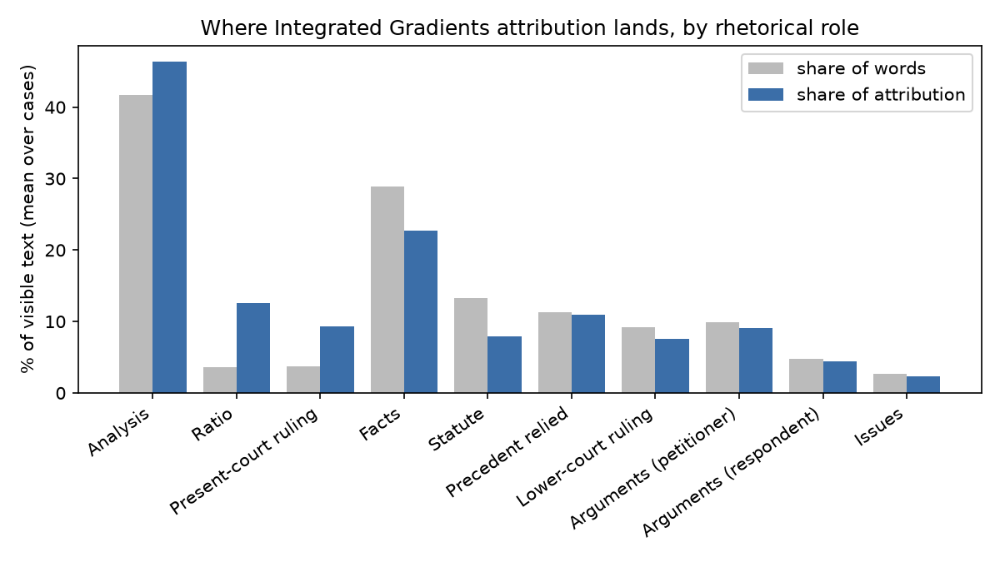
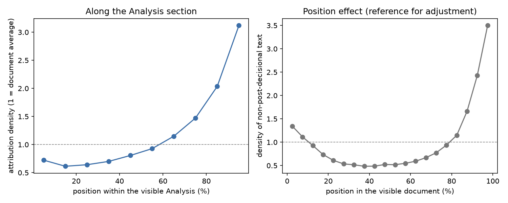

# Stage 3 — Integrated Gradients vs expert rationale: results (v2)

**Status (13 Oct 2026):** the v2 Stage-3 run is complete and analysed (1,346 PredEx cases, Modal L4 GPUs).
Every number here comes from `stage3_outputs_modal/paper_v2/` and is regenerated on a laptop, without a
GPU, by:

```bash
python stage3_analysis.py --run-dir stage3_outputs_modal/paper_v2      # tables, figures (analysis/)
python stage3_validate_paper.py                                       # validation_report.*
```

## 1. The result in one paragraph

Integrated Gradients (IG) puts more of the model's attribution on post-decisional text than its length
alone would give: Analysis, Ratio and the present-court ruling hold 43% of the words the model sees but
51% of the attribution, while Facts and Statute get less than their share. Most of this is explained by
**where** the text sits. The model's attribution is strongly U-shaped over the document: the last part
of what it reads gets about 3.5 times the average attribution, and the middle about half. After
comparing each role with other text at the same position, the Analysis section as a whole is no longer
favoured (0.96), but the short outcome-stating parts still are (Ratio 1.49, present-court ruling 1.61),
and Statute stays below (0.76). The PredEx expert rationale is itself mostly post-decisional text (80%
Analysis, 2% Facts), so agreement with it rewards the leakage Stage 2 found instead of revealing it.
Case by case, IG's attribution to the Analysis hardly tracks how much the Analysis drives the prediction
in the Stage-2 experiments. Stage 3 therefore supports Stage 2 on direction (outcome-stating text in,
statute out), but shows that attribution maps and expert-rationale overlap cannot detect this shortcut
on their own; the behavioural tests of Stage 2 remain the primary evidence.

## 2. What changed since the first Stage-3 run

The first run (`stage3_outputs_modal/paper/`, September 2026) predates Stage 2 v2.

| First run | v2 run | Why |
|---|---|---|
| Joined the v1 Stage-2 file (the run where every Statute sentence was lost) | Joins `predex_ablation_results_v2.json` and the Controls A–F file | v1 Stage-2 results are wrong |
| No rhetorical-role lookup, so no role results | v2 segmentation (`stage2_outputs/stage3_role_lookup_v2.json`), looked up by row index | Role attribution is the link to Stage 2. Looking up by name gave one of two cases with the same title the other's roles |
| IG explained one class logit | IG explains the decision margin (predicted logit minus the other) | For two classes, P(predicted) = sigmoid(margin), so the margin is the quantity the decision rests on. A single logit also credits text that raises both logits |
| No IG accuracy check | Completeness error checked per case; cases above 5% recomputed with 128 steps | See Section 3 |
| 155 cases with the rationale outside the model's window got no attribution | Every case attributed; those 155 only lack IoU | They are the longest judgments (6,031 vs 2,543 words); dropping them biases the role results |
| Pooled "shortcut roles" included Statute and Precedent (the Review-1 framing) | Pooled post-decisional roles: Analysis, Ratio, present-court ruling | Matches STAGE2_RESULTS.md Section 5 |
| Per-word scores discarded | Saved in `word_scores.npz` (magnitude, sign, visibility, rationale, roles) | All analysis runs on CPU; new questions need no GPU |

Unchanged: model checkpoint (epoch 4, F1 0.732), chunking (512/256/16), PAD baseline, 10% masking
faithfulness test, rationale alignment. Expert-rationale IoU barely moved (0.265 → 0.267).

## 3. Checks that the run is sound

- **All cases, model reproduced.** 1,346 rows, one per PredEx row index, no errors. Accuracy 71.55%
  (Stage 1: 71.46%; Stage-2 raw text: 71.5%).
- **IG accuracy.** IG attributions should add up to F(input) − F(baseline). Median error 2.3% of that
  gap; 83.3% of cases within 5%, 61 cases (4.5%) above 10%, 4 above 20%. 75% of cases needed the
  128-step recomputation; cases still above 5% are somewhat more often truncated (43% vs 33%). Rerunning
  the analysis on only the 1,121 cases within 5% changes no conclusion (Section 6).
- **Faithfulness.** Masking the 10% of words IG ranks highest moves the decision margin 0.86 more than
  masking the lowest-ranked 10% (CI 0.79–0.93); the gap is positive in 73% of cases (first run: 72.6%,
  measured on a single logit, so the gap sizes are not comparable). Where it is not positive, accuracy
  is lower (55.7% vs 78.2%).
- **Role tagging.** 0.02% of visible words carry two roles and 0.83% none.
- **Truncation.** 32.8% of judgments are longer than the model's 16-chunk window (about 4,350 tokens).
  All measures use only the text the model actually reads.

## 4. Results



### 4.1 Where attribution lands, by role (H1)

Mean over cases containing the role. "Excess" = attribution share − word share (percentage points).
"Position-adjusted" divides each word's attribution by what non-post-decisional text (facts,
arguments, statute, precedent, lower-court ruling) gets at the same position in the judgment, across
all cases: 1 means "what its position predicts".

| Role | Cases | Share of words | Share of attribution | Excess | Position-adjusted |
|---|---|---|---|---|---|
| Post-decisional (pooled) | 1,321 | 43.2% | 51.4% | **+8.3** [7.7, 8.8] | 0.97 [0.96, 0.98] |
| Analysis | 1,310 | 41.7% | 46.3% | +4.6 [4.0, 5.2] | 0.96 [0.95, 0.98] |
| Ratio | 416 | 3.6% | 12.6% | +8.9 [8.3, 9.5] | **1.49** [1.40, 1.58] |
| Present-court ruling | 221 | 3.7% | 9.3% | +5.5 [4.7, 6.4] | **1.61** [1.45, 1.77] |
| Facts | 1,306 | 28.9% | 22.7% | −6.2 [−6.7, −5.7] | 0.99 [0.98, 1.01] |
| **Statute** | 504 | 13.3% | 7.9% | **−5.4** [−6.0, −4.8] | **0.76** [0.74, 0.79] |
| Precedent relied | 697 | 11.3% | 10.9% | −0.3 [−0.9, 0.2] | 0.90 [0.88, 0.93] |
| Lower-court ruling | 1,092 | 9.2% | 7.5% | −1.7 [−2.0, −1.5] | 1.03 [1.00, 1.05] |
| Arguments (petitioner) | 817 | 9.9% | 9.1% | −0.8 [−1.2, −0.4] | 1.48 [1.42, 1.53] |
| Arguments (respondent) | 665 | 4.7% | 4.4% | −0.3 [−0.5, −0.0] | 1.41 [1.35, 1.47] |

Reading it:

- Without the position adjustment, the picture matches Stage 2: post-decisional text is
  over-attributed and Statute under-attributed.
- The position effect is large. Non-post-decisional text gets 3.5× the average attribution in the last
  5% of the visible document, 1.3× in the first 5% and about 0.5× in the middle
  (`analysis/fig_position.png`). A likely cause is the architecture: the Bi-GRU's output is its final
  states, which sit at the last chunk (forward direction) and the first chunk (backward direction).
  Analysis is the long section that runs up to the end of most judgments, so its raw excess is mostly
  position.
- At equal position, Ratio and the present-court ruling, the shortest and most outcome-explicit
  post-decisional text, still get about 1.5× the attribution. Statute gets 0.76× even at equal position.
  Arguments are above 1 (1.4×), which a leakage account does not predict; the parties' arguments are
  written before the decision, so this is not leakage, but it does show IG favouring argumentative text.
- Signed attribution: 59% of the Analysis's attribution pushes toward the predicted class, against 53%
  for Facts (`analysis/role_shares.csv`, column `support_share`).



### 4.2 Start vs end of the Analysis (H2)

Same definition as Stage-2 Control C: the first and last 60 or 150 words of the Analysis. Density 1 =
the document average.

| Words | Cases scored | End not visible | First part | Last part | Position-adjusted: first | last |
|---|---|---|---|---|---|---|
| 60 | 855 | 433 | 0.72 [0.69, 0.75] | **3.19** [3.07, 3.33] | 1.14 [1.11, 1.18] | 1.04 [1.01, 1.08] |
| 150 | 739 | 431 | 0.62 [0.60, 0.64] | **2.62** [2.53, 2.70] | 1.03 [1.00, 1.06] | 1.00 [0.98, 1.02] |

The end of the Analysis gets 3–4 times more attribution than its start, but after the position
adjustment both are close to 1. With IG on full judgments, "end of the Analysis" cannot be separated
from "end of the document". In 433 cases (about a third of those long enough) the end of the Analysis is
outside the model's window altogether. Stage-2 Control C, where the first and last Analysis words are
placed at the same spot after the facts, remains the evidence that the end carries more outcome
information (+7.1 vs +2.5 pp toward the truth).

### 4.3 The expert rationale and a role-matched baseline (H3)

Share of the visible PredEx expert rationale in each role, cases with status `ok` (n = 1,182):

| Role | Share of words | Share of expert rationale |
|---|---|---|
| Analysis | 42.9% | **79.6%** |
| Ratio | 3.6% | 14.0% |
| Present-court ruling | 3.7% | 10.7% |
| Precedent relied | 11.4% | 9.5% |
| Statute | 12.9% | 6.8% |
| Arguments (petitioner) | 9.6% | 3.6% |
| **Facts** | 27.7% | **2.0%** |

(Means over the cases containing each role, so the columns do not add to 100%.)

IoU between the model's top words and the expert rationale, at the rationale's size:

| Selection | IoU |
|---|---|
| Model (IG) | 0.267 [0.259, 0.274] |
| Random words | 0.166 [0.159, 0.173] |
| Random words with the same role mix as the model's top words | 0.216 [0.208, 0.224] |
| Model − role-matched | +0.051 [0.047, 0.055] |

The experts marked the court's reasoning, almost never the facts. About half of the model's advantage
over random (0.10) comes from both preferring the same roles; within roles the model still matches the
expert words better than chance (+0.05). The consequence for the method: on PredEx, high agreement with
the expert rationale is what a model that reads the outcome from the court's reasoning would show. This
plausibility measure cannot detect the leakage; it rewards it.

IoU is also much lower when the document is truncated (0.165 vs 0.299), because the visible part of the
rationale is then shorter and earlier.

### 4.4 Case-by-case link to Stage 2 (H4)

Spearman correlation between a case's Analysis attribution excess and its Stage-2 behaviour
(1,272 cases with both):

| Stage-2 measure | rho [95% CI] |
|---|---|
| v2: P(true) gained by adding the Analysis to the facts | −0.03 [−0.08, 0.03] |
| Control B: P(true) lost removing the Analysis, beyond random deletion | **+0.10** [0.04, 0.15] |
| Control D: follows a transplanted Analysis | −0.06 [−0.11, 0.00] |

Only the leave-one-out control (the one done on near-full documents, like Stage 3) shows a link, and it
is weak. IG's per-case attribution to the Analysis is not a usable per-case detector of the reliance that
the behavioural tests measure. The Analysis excess is similar for correct (+4.3 pp) and incorrect
(+5.4 pp) predictions.

## 5. What to claim

> Integrated Gradients attributions point the same way as the behavioural results: outcome-stating
> court text (Ratio, present-court ruling) receives about 1.5 times the attribution of other text at the
> same position, and statute text about three quarters. But the attributions are dominated by position
> (about 3.5 times the average at the end of the text the model reads), which by itself makes the long
> Analysis section look important, and they barely track, case by case, how much the Analysis drives the
> prediction. The PredEx expert rationales are 80% Analysis and 2% facts, so agreement with them
> (IoU 0.27, against 0.22 for random words with the same role mix) is what outcome leakage looks like,
> not evidence against it. Explanation-based audits of legal judgment prediction should therefore
> control for position and rationale composition, and be paired with behavioural tests.

Keep the terminology from Stage 2: "post-decisional" or "outcome-bearing" text, not "spurious".

## 6. Robustness and threats to validity

| Check / threat | Result |
|---|---|
| Only cases with IG error ≤ 5% (1,121) | Post-decisional excess +8.2 pp; position-adjusted Analysis 0.95, Ratio 1.45, present-court ruling 1.63, Statute 0.76; H2 adjusted first/last 1.00/0.99; role-matched IoU gap +0.051; Control B rho +0.11. No conclusion changes |
| 10 position bins instead of 20 | Analysis 0.97, Ratio 1.76, present-court ruling 1.86, Statute 0.75; H2 adjusted 1.02/1.06. Same conclusions; Ratio and ruling slightly stronger |
| The position adjustment could remove a real effect, since outcome text sits at the end by nature | The reference is built only from non-post-decisional text, which shows the same end-of-document rise, so position matters regardless of content. The raw and adjusted numbers are both reported |
| One attribution method, one baseline (PAD) | Stated. Gradient × input is implemented; other baselines were not run |
| Segmentation errors (OpenNyAI weighted F1 ≈ 0.78) | Same segmentation as Stage 2, so the two stages are comparable. Statute/Analysis confusion would blur, not create, the Statute result |
| IoU depends on how many words are selected | Reported at the rationale's size and at the top 5/10/20% (`summary.txt`) |

## 7. Files

| File | Purpose |
|---|---|
| `modal_stage3.py` | GPU run on Modal: 8 parallel shards, resumable, coordinated on Modal so the laptop can disconnect |
| `stage3/` | Audit package (alignment, IG adapter, metrics, report); `word_store.py` saves per-word arrays |
| `stage3_analysis.py` | CPU analysis H1–H4 → `paper_v2/analysis/` (`tables.md`, CSVs, figures, `summary.json`) |
| `stage3_validate_paper.py` | Permutation tests, truncation and faithfulness subgroups → `validation_report.*` |
| `stage3_outputs_modal/paper_v2/` | This run: per-case results, `word_scores.npz`, summaries, 20 HTML heatmaps |
| `stage3_outputs_modal/paper/` | The first Stage-3 run (v1 Stage-2 join), kept for comparison |
| `stage3/tests/` | 30 tests, no GPU needed |

GPU cost: about 18 L4-hours across the interrupted and resumed runs, plus smoke tests.
