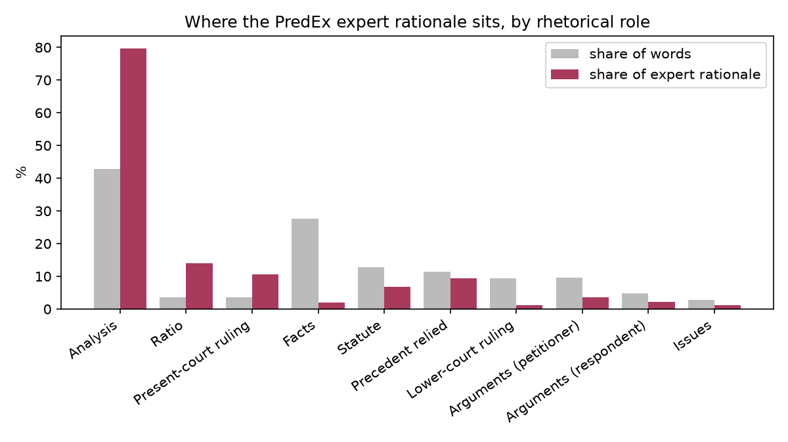

# Stage 3 v2 analysis

Generated by `stage3_analysis.py` from `/outputs/paper_v2`.

## Quality

- Cases: 1346 (1346 with attributions). Statuses: {'ok': 1182, 'rationale_out_of_context': 155, 'low_rationale_coverage': 9}
- Accuracy 71.5%
- IG completeness: median relative delta 0.023; within 5%: 83.3%; recomputed with more steps: 75.1%
- Faithfulness gap (top-10% masked minus bottom-10% masked, decision margin): 0.859 [0.788, 0.927]; positive in 73.0% of cases

## H1. Attribution by rhetorical role

Mean over cases containing the role (visible part only). Excess = attribution share − word share. Position-adjusted = attribution density relative to non-post-decisional text at the same position in the judgment (1 = what position alone predicts). Support = share of the role's signed attribution that pushes toward the predicted class. Brackets are 95% bootstrap CIs over cases. Adjusted words = share of the role's words at positions with a reference.

| Role | Cases | Words | Attribution | Ratio | Excess (pp) | Position-adjusted | Adjusted words | Support |
|---|---|---|---|---|---|---|---|---|
| Post-decisional (Analysis+Ratio+RPC) | 1321 | 43.2% | 51.4% | 1.19 | +8.3 [+7.7, +8.8] | 0.969 [0.959, 0.980] | 100% | – |
| Analysis | 1310 | 41.7% | 46.3% | 1.11 | +4.6 [+4.0, +5.2] | 0.963 [0.952, 0.975] | 100% | 59.0% |
| Ratio | 416 | 3.6% | 12.6% | 3.46 | +8.9 [+8.3, +9.5] | 1.490 [1.396, 1.578] | 100% | 62.2% |
| Present-court ruling | 221 | 3.7% | 9.3% | 2.48 | +5.5 [+4.7, +6.4] | 1.608 [1.451, 1.772] | 100% | 60.0% |
| Facts | 1306 | 28.9% | 22.7% | 0.78 | -6.2 [-6.7, -5.7] | 0.991 [0.976, 1.007] | 100% | 53.0% |
| Statute | 504 | 13.3% | 7.9% | 0.59 | -5.4 [-6.0, -4.8] | 0.760 [0.735, 0.790] | 100% | 56.3% |
| Precedent relied | 697 | 11.3% | 10.9% | 0.97 | -0.3 [-0.9, +0.2] | 0.904 [0.875, 0.934] | 100% | 56.6% |
| Lower-court ruling | 1092 | 9.2% | 7.5% | 0.81 | -1.7 [-2.0, -1.5] | 1.026 [1.002, 1.053] | 100% | 53.5% |
| Arguments (petitioner) | 817 | 9.9% | 9.1% | 0.91 | -0.8 [-1.2, -0.4] | 1.475 [1.418, 1.529] | 100% | 58.3% |
| Arguments (respondent) | 665 | 4.7% | 4.4% | 0.94 | -0.3 [-0.5, -0.0] | 1.407 [1.349, 1.466] | 100% | 56.3% |
| Issues | 295 | 2.6% | 2.3% | 0.87 | -0.3 [-0.5, -0.1] | 1.086 [1.020, 1.156] | 100% | 54.7% |

## H2. Start vs end of the Analysis

Density = mean attribution per word in the part / mean per visible word. Position-adjusted divides by the density non-post-decisional text gets at the same position, since the end of the Analysis is usually near the end of the judgment.

| Words | Scored cases | End truncated | First part | Last part | Last − first | Position-adjusted: first | last | last: adjusted words |
|---|---|---|---|---|---|---|---|---|
| 60 | 855 | 433 | 0.723 [0.694, 0.752] | 3.190 [3.067, 3.325] | +2.467 [+2.332, +2.611] | 1.143 [1.105, 1.181] | 1.040 [1.006, 1.076] | 100% |
| 150 | 739 | 431 | 0.621 [0.601, 0.641] | 2.615 [2.533, 2.700] | +1.994 [+1.907, +2.085] | 1.027 [0.998, 1.055] | 0.996 [0.975, 1.017] | 100% |

## H3. Expert rationale and the role-matched baseline

Cases with audit_status ok. Mean share of the visible expert rationale per role:

| Role | Share of words | Share of rationale |
|---|---|---|
| Analysis | 42.9% | 79.6% |
| Ratio | 3.6% | 14.0% |
| Present-court ruling | 3.7% | 10.7% |
| Facts | 27.7% | 2.0% |
| Statute | 12.9% | 6.8% |
| Precedent relied | 11.4% | 9.5% |
| Lower-court ruling | 9.3% | 1.1% |
| Arguments (petitioner) | 9.6% | 3.6% |
| Arguments (respondent) | 4.8% | 2.1% |
| Issues | 2.7% | 1.2% |

IoU at the expert-rationale size (n=1182):

- Model: 0.267 [0.259, 0.274]
- Uniform random words: 0.166 [0.159, 0.173]
- Random words with the model's role mix: 0.216 [0.208, 0.224]
- Model − role-matched: +0.051 [+0.047, +0.055]

## H4. Case-by-case link to Stage 2

Spearman correlation between the Analysis attribution excess (Stage 3) and each Stage-2 measure, with 95% bootstrap CI.

| Stage-2 measure | n | rho | 95% CI |
|---|---|---|---|
| v2: P(true) gained by adding Analysis to facts | 1272 | -0.025 | [-0.084, +0.030] |
| Control B: P(true) lost removing Analysis, beyond random | 1272 | +0.099 | [+0.044, +0.153] |
| Control D: follows a transplanted Analysis | 1272 | -0.055 | [-0.111, +0.001] |

Analysis excess when the prediction is correct: +4.3 [+3.5, +5.0]; incorrect: +5.4 [+4.3, +6.5]

## Figures

